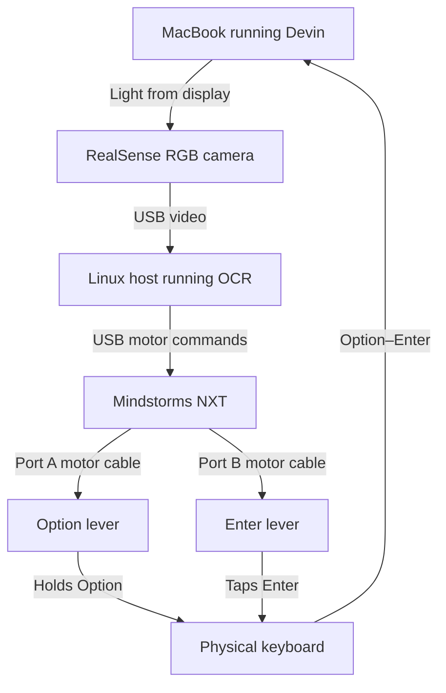

# Devin Mindstorms permission clicker

You ask [Devin](https://devin.ai/), a coding agent, to run the tests while you review a pull request. An hour later, you come back for the results. Devin is still waiting for permission to run the same command you approved yesterday. After a few rounds of this, you start checking on Devin in the middle of a diff, just in case. This project lets you choose which recurring requests a LEGO robot can approve on your behalf.

On some corporate-managed MacBooks, you can't install a helper app. The goal is to use just a camera and a LEGO Mindstorms NXT. The camera recognizes a configured card and tells the NXT to press **Option–Enter** on a real keyboard. This requires a camera that can boot its own recognition program and communicate directly with the brick.

### Current prototype

The software currently targets an **Intel RealSense D415 or D435** attached to a separate Linux computer. Those cameras compute stereo depth onboard and stream images over USB. The Linux computer reads the RGB stream, recognizes the card, and drives the NXT over its USB cable. Running recognition on a standalone camera and controlling the brick directly still need implementation and bench testing. [RealSense D400 datasheet](https://www.realsenseai.com/wp-content/uploads/2026/03/RealSense-D400-Series-Datasheet-Mar-2026.pdf)

Two eyes on the stereo camera plus two on the operator give you a literal **four eyes**. Corporate security might even sign off, provided your policy allows automated approval for the commands you've chosen.



[camera.py](camera.py) reads RGB frames through Linux V4L2 and sends a cropped grayscale frame to Tesseract's pretrained LSTM engine. [clicker.py](clicker.py) requires two consecutive matching reads, holds Option with motor A, and checks one more fresh camera frame before tapping Enter with B. It then releases Enter and Option. The Linux host handles all recognition and motor commands. [OpenCV VideoCapture](https://docs.opencv.org/4.x/d8/dfe/classcv_1_1VideoCapture.html) · [Tesseract neural OCR](https://tesseract-ocr.github.io/tessdoc/) · [NXT-Python USB setup](https://ni.srht.site/nxt-python/latest/installation.html)

## Hardware and wiring

| Device | Connection |
| --- | --- |
| Intel RealSense D415 or D435, assumed | USB 3 to the Linux host. Use the V4L2 node for its dedicated RGB stream. |
| NXT brick with power and two NXT servos | USB data cable to the Linux host. Connect the Option motor to port **A** and Enter to **B**. |
| Real keyboard | Pair or plug it into the MacBook as usual. |

The original NXT **8527**, NXT 2.0 **8547** and Education **9797** can use the same two-motor fixture. The [illustrated PDF booklet](output/pdf/nxt-keyboard-presser.pdf) starts with a parts inventory and walks through assembly, wiring, and bench calibration. See the [build guide](LEGO-BUILD.md) for additional fitting details and the PDF build command. [8527 instructions](https://www.lego.com/en-us/service/building-instructions/8527) · [8547 instructions](https://www.lego.com/en-us/service/building-instructions/8547) · [9797 instructions](https://www.lego.com/en-us/service/building-instructions/9797)

The example configuration assumes a RealSense D415 or D435. Both list **1920×1080 at 30 fps** on their dedicated color stream over USB 3. The datasheet calls the format YUY2, which V4L2 calls `YUYV`. The depth and color streams use separate interfaces. If you later want to distinguish the two cameras, `lsusb` lists `8086:0ad3` for a D415 or `8086:0b07` for a D435. [RealSense D400 datasheet, tables 4-1 and 4-2](https://www.realsenseai.com/wp-content/uploads/2026/03/RealSense-D400-Series-Datasheet-Mar-2026.pdf)

## Install on the Linux host

On a Debian-based host such as Raspberry Pi OS or Ubuntu:

```sh
sudo apt install make python3-venv python3-opencv libusb-1.0-0 v4l-utils tesseract-ocr tesseract-ocr-eng
python3 -m venv --system-site-packages .venv
.venv/bin/python -m pip install -r requirements.txt
cp config.example.json local.json
```

If the brick shows in `lsusb` but the driver cannot open it, configure the NXT USB device permissions for your Linux user. [NXT-Python Linux USB permissions](https://ni.srht.site/nxt-python/latest/installation.html#usb-access-permissions-for-linux)

## Simulate without hardware

```sh
make test PYTHON=.venv/bin/python
make demo PYTHON=.venv/bin/python
```

The demo sends sample card images through the same OCR and recognition gate as the camera feed, then prints the simulated Option–Enter sequence. One frame contains a different command with the same approval label. You can replace the example images with saved camera frames and run the same simulator. It validates software behavior. Mechanics, glare and focus require a bench test. Open Roberta has an NXT simulator for exploring motor programs, and MuJoCo can model linkage and key contact if you build the geometry. [Open Roberta simulation](https://www.open-roberta.org/features/) · [MuJoCo](https://mujoco.readthedocs.io/en/stable/)

## Teach the watcher your permission cards

1. Connect the camera to a USB 3 port on the Linux host. List nodes with `v4l2-ctl --list-devices` and inspect each RealSense candidate with `v4l2-ctl -d /dev/videoN --list-formats-ext`, substituting its actual node name. Select the node listing `YUYV` at 1920×1080 and 30 fps. Set `camera.device` to that node or its persistent `/dev/v4l/by-id/` path. If the listing is limited to lower resolutions, check the USB link with `lsusb -t` and try the camera's USB 3 cable directly into the host.
2. Aim the camera squarely at the area where Devin shows the request. Keep the mount rigid and the panel position fixed. Adjust the distance until the full action and approval control are sharp. Reduce reflections and leave enough room in the frame for the complete action text.
3. Open a harmless Devin prompt in a disposable workspace. Verify by hand that **Option–Enter** grants the one-time approval you intend. Check that the card text remains readable while Option is held. Save a calibration image and inspect it on the Linux host. [Devin Local Permissions](https://docs.devin.ai/desktop/devin-local/permissions)

   ```sh
   .venv/bin/python clicker.py snapshot local.json camera-test.png
   .venv/bin/python clicker.py inspect-image local.json camera-test.png
   ```

4. Confirm that `snapshot` reports 1920×1080 and that the saved image shows sharp color text. Set `screen.crop` to `[left, top, width, height]` as fractions of the **camera image**, measured from its top-left. Include the full card and exclude unrelated text. Run `inspect-image` again, compare the result to the visible card, and copy the OCR lines into `screen.prompt_lines` in order. Teach other verified cards via `screen.additional_prompt_lines`, one list of lines per card. Use `check-image` to verify an already configured image.
5. Run the dry watcher first. Try a different prompt and verify that it stays idle, then show the intended prompt. After completing the fixture bench test, use live mode on the same disposable workspace. Keep the Mac awake and Devin visible. A camera can check the visible card text, and macOS keyboard focus remains a separate physical test.

   ```sh
   .venv/bin/python clicker.py watch local.json
   .venv/bin/python clicker.py watch local.json --live
   ```

If the card stays in a fixed location and full-card OCR merges the buttons or misses the approval label, set `screen.ocr_regions` to one single-line crop per entry in `screen.prompt_lines`, in the same order. Each crop is a fraction of the full source frame, like `screen.crop`. Test the individual lines on a saved image with `clicker.py check-image` before enabling the watcher.

### Find cards that move within the panel

Set `screen.anchor` to enable a panel-wide search. Use a full reference image with a short command. Set `image` to its path relative to the config file, `panel` to the whole search area, and `heading` and `allow` to small crops around the card title and Allow button. Measure all crops as fractions of that full image.

```json
{
  "image": "captures/reference.png",
  "panel": [0.30, 0.10, 0.39, 0.73],
  "heading": [0.341, 0.352, 0.123, 0.022],
  "allow": [0.520, 0.450, 0.061, 0.032],
  "minimum_score": 0.85
}
```

Measure `screen.crop` and exactly three `screen.ocr_regions` in the same reference image. Use the full card for `crop` and the heading, command area, and Allow label for the three OCR regions. The heading and button locate the card horizontally and vertically. The distance between them determines how tall to make the command crop so OCR can read each displayed line. Include every line in the configured fingerprint in display order. When enabled, the visual classifier checks the relocated full card.

The reference and live frames need the same resolution, camera position, and UI scale. Keep the full card inside the search panel. The watcher waits if either anchor is missing or has multiple possible matches.

The watcher defaults to one match and five minutes. To rearm automatically, set `screen.clear_lines` to a stable OCR result from the same crop after the card clears, then add `--repeat`. A missing camera frame or unreadable card does not rearm it. To test the NXT separately, run `.venv/bin/python clicker.py brick` on the Linux host.

## Train a visual card model locally

`card_model.py` trains an OpenCV classifier on card shape and layout. It runs locally on saved screenshots or camera frames. It adds blur, brightness and perspective variants to training images and evaluates only the original held-out images. Run the synthetic smoke test with `make model-demo PYTHON=.venv/bin/python`.

1. In Devin Local, use a disposable workspace. Capture the permission card for a harmless request such as `printf 'nxt-card-test'`, dismiss the request, and capture the same area after it clears. Capture additional requests, ordinary editor views, and dialogs with similar-looking buttons. Save cropped images under `captures/` or specify a fractional `crop` for each full image. A permission card for a different command is a **permission** example for the visual model. The existing OCR configuration covers the exact action the watcher can accept. [Devin Local Permissions](https://docs.devin.ai/desktop/devin-local/permissions)
2. Save `captures/manifest.json` as a JSON array. Each entry uses this form. Paths are relative to the manifest. Use `permission` or `other` as the label and `train` or `test` as the split. Give screenshots and frames from each recording session the same `group`, and keep the whole group in one split. Collect both labels in both splits, and reserve an independently captured set of actual camera frames for testing before live use.

   ```json
   {"image": "card.png", "label": "permission", "group": "session-01", "split": "train"}
   ```

3. Train, inspect the held-out error counts, and test individual images. To add the visual check to a camera dry run, pass `--card-model`. A visual match is required in addition to the exact OCR match when the model is supplied.

   ```sh
   .venv/bin/python card_model.py train captures/manifest.json captures/card-model.xml
   .venv/bin/python card_model.py predict captures/card-model.xml captures/card.png
   .venv/bin/python clicker.py watch local.json --card-model captures/card-model.xml
   ```

The synthetic demo checks the training and prediction code. Devin screenshots provide test examples for layout. Frames from the mounted camera are needed to measure performance through glare, perspective, and screen artifacts. The deployed recognizer uses the external camera on the Linux host.

## Development checks

Install and run the Git hooks from the project directory with Python 3.11. The hooks run Ruff, ty, and basic file checks. GitHub Actions runs the same hooks, unit tests, and the two offline demos on pushes and pull requests.

```sh
.venv/bin/python -m pip install -r requirements-dev.txt
.venv/bin/pre-commit install
.venv/bin/pre-commit run --all-files
make typecheck test demo model-demo
```

Real screenshots and trained models are stored in the Git-ignored `captures/` directory. CI uses synthetic fixtures, including generated panels with varying amounts of surrounding text and cards with one to eight command lines.
